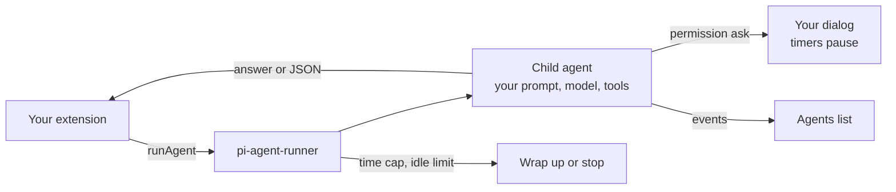

# pi-agent-runner

Run child agents from your Pi extension. One call gives you a second agent
with its own prompt, tools and model, working next to you in the same Pi
session.

```
agents ─────────────────────────────────────────── 2 running · 1 waiting
⠋ spiral-executor  ralph US-002  gpt-6-luna  t4  bash             12.3k  0:41
⏸ spiral-critic    ralplan #2    opus-5      t2  waiting for you         1:05
✓ scout            opium         gpt-6-luna  t6  done              8.1k  0:22
```

**Just want this in Pi?** You don't need this library directly. Install one
of the plugins built on it:

```sh
pi install git:github.com/akholod/pi-opium   # orchestrator, specialists, council
pi install git:github.com/akholod/pi-spiral  # /ralplan and /ralph
```

## Why

You ask Pi to fix the failing tests. A fixer agent takes it in the
background, while you and Pi talk through the next feature. A minute later
the list above shows `✓ fixer done`, and its report lands in your session.

Getting there takes plumbing every plugin would otherwise rewrite: which
model the child gets, which tools it may touch, what happens when it asks
for permission, how to stop it when it hangs, how to see what it is doing.
This library is that plumbing, solved once.

## Who uses it

- **[Opium](https://github.com/akholod/pi-opium)** turns your Pi session
  into an orchestrator. It hands work to specialists (scout, researcher,
  senior, designer, fixer…), runs them in the background, and asks a
  council of different models when a decision matters.
- **[Spiral](https://github.com/akholod/pi-spiral)**: `/ralplan` gets a plan
  past a planner, an architect and a critic; `/ralph` turns it into stories
  and keeps an executor and a reviewer going until every story passes.

Or build your own: a review loop, a bot for failing tests, a team with your
own roles. The runner doesn't care how you orchestrate.

**Why not pi-subagents?** That is a tool the model calls. This is a library
your code calls: you decide when a child runs and what happens with its
result. Children run inside your Pi process, so they start fast and share
your providers.

## What happens to a child



## Quick start

```sh
npm install pi-agent-runner
```

```ts
// review.ts
import type { ExtensionAPI } from '@earendil-works/pi-coding-agent';
import { mountRunsView, runAgent } from 'pi-agent-runner';

export default function (pi: ExtensionAPI) {
  let view: { dispose(): void } | undefined;
  pi.on('session_start', (_event, ctx) => {
    view = mountRunsView(ctx); // the shared agents list
  });
  pi.on('session_shutdown', () => view?.dispose());

  pi.registerCommand('review', {
    handler: async (args, ctx) => {
      const result = await runAgent({
        parent: { events: pi.events, ctx },
        cwd: ctx.cwd,
        label: { name: 'reviewer' },
        systemPrompt: 'You review code. Point to files and lines.',
        task: `Review ${args}`,
        tools: ['read', 'grep', 'find', 'ls'],
        model: 'inherit', // or 'provider/id'
      });
      ctx.ui.notify(String(result.value ?? result.error), 'info');
    },
  });
}
```

Try it with `pi -e ./review.ts`, then type `/review src/`.

## What you get

- **Your rules apply.** The child gets the model you choose, only the
  tools you allow and your permission rules. Its permission questions open
  in your dialog, and its timers pause while you decide.
- **It stops cleanly.** Set a time cap, an idle limit and a per-tool limit.
  When time runs out the child is asked to wrap up and report instead of
  being cut off.
- **Long-lived agents.** `startAgent` keeps the session: message it while
  it works, cancel and continue, reopen it from its transcript later.
- **Structured answers.** Pass a JSON Schema, get validated data back.
- **Guards.** A tool allowlist, a git guard against destructive commands,
  read roots and a nesting limit, plus your own extensions in every child.
- **One live list.** Children from every plugin show in the same view; use
  `liveRuns()` to draw your own.
- **A real kill switch.** `backend: 'process'` runs a child as a separate
  `pi` process that can be killed, along with anything it started.

Needs Pi 1.1 or newer. The API is still 0.x and may change between minor
versions, so pin one (`^0.6.0`).

## Docs

Options, statuses, timeouts and known limitations:
[docs/reference.md](https://github.com/akholod/pi-agent-runner/blob/main/docs/reference.md).

## Development

```sh
npm install
npm run typecheck
npm run lint
npm test
npm run test:live  # real models, about a minute
```

MIT
